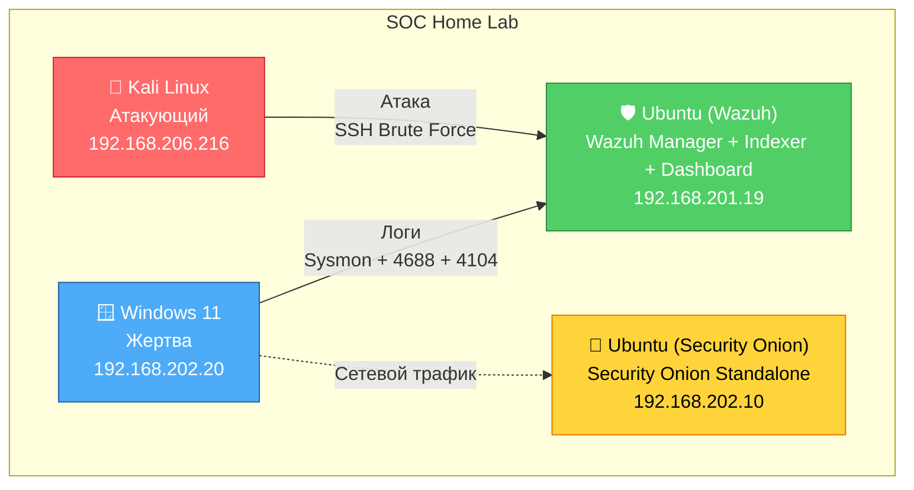

# Архитектура лаборатории

## Схема сети

## Ресурсы VM

| VM | CPU | RAM | Диск |
|----|-----|-----|------|
| Ubuntu (Wazuh) | 4 | 8 ГБ | 226 ГБ |
| Kali | 2 | 4 ГБ | 40 ГБ |
| Windows 11 | 4 | 8 ГБ | 80 ГБ |
| Ubuntu (Security Onion) | 4 | 24 ГБ | 200 ГБ |

## Источники телеметрии

| Источник | Что даёт | Где используется |
|----------|----------|------------------|
| Sysmon EID 1 | Process Create | Правила на процессы |
| Sysmon EID 10 | Process Access | Мониторинг LSASS |
| Sysmon EID 3 | Network Connect | Reverse shell |
| Windows Security 4688 | Process Create | **Основной** источник для детектов |
| PowerShell 4104 | ScriptBlock | AMSI Bypass, обфускация |
| Windows Security 4624/4625 | Logon | Brute force |

## Порты

- **1514/tcp** — Wazuh Agent → Manager.
- **1515/tcp** — Wazuh Enrollment.
- **443/tcp** — Wazuh Dashboard.
- **8220/tcp** — Elastic Fleet (Security Onion).
- **5055/tcp** — Elastic Agent (Security Onion).
